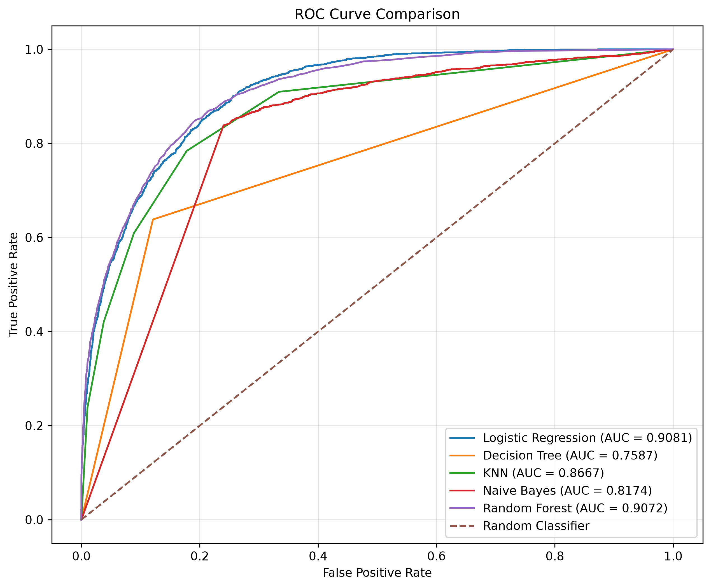

# Adult Census Income Classification

## 1. Problem Statement

The objective of this project is to implement, evaluate, and compare five machine-learning classification algorithms to predict whether an individual's annual income exceeds $50,000 based on demographic, educational, and employment-related attributes.

This is a binary classification problem with two target classes:

- `<=50K`: Annual income at or below $50,000.
- `>50K`: Annual income above $50,000.

The project implements five classification algorithms using the same dataset and evaluates their performance using six standard classification metrics to identify the model that provides the best overall classification performance.

## 2. Dataset Description

**Dataset:** Adult Census Income Dataset  
**Source:** UCI Machine Learning Repository  
**Dataset URL:** https://archive.ics.uci.edu/dataset/2/adult

### 2.1 Reason for Dataset Selection

The Adult Census Income Dataset was selected because it is a well-established public benchmark dataset containing real-world demographic, educational, and employment-related attributes for binary income classification.

It satisfies and exceeds all assignment requirements by providing:

- 48,842 original instances (well above the minimum requirement of 1,000 instances).
- 14 input features (above the minimum requirement of 12 features).
- A mix of both numerical and categorical features requiring encoding and scaling.
- Real-world missing values (both null values and `?` markers) and duplicate records requiring structured preprocessing.
- An imbalanced target variable that allows meaningful evaluation across Accuracy, AUC, Precision, Recall, F1, and MCC.

### 2.2 Dataset Characteristics

| Attribute | Description |
|---|---|
| Original records | 48,842 |
| Cleaned records (after duplicate removal) | 48,790 |
| Original input features | 14 |
| Target variable | `income` |
| Classification type | Binary |
| Numerical features | 6 |
| Categorical features | 8 |
| Original columns | 15 |

### 2.3 Input Features and Feature Types

| # | Feature Name | Feature Type | Description |
|---:|---|---|---|
| 1 | `age` | Numerical | Age of the individual |
| 2 | `workclass` | Categorical | Employment type (e.g., Private, State-gov, Self-emp) |
| 3 | `fnlwgt` | Numerical | Final census sampling weight |
| 4 | `education` | Categorical | Highest level of education completed |
| 5 | `education-num` | Numerical | Numerical representation of education level |
| 6 | `marital-status` | Categorical | Marital status of the individual |
| 7 | `occupation` | Categorical | General occupation category |
| 8 | `relationship` | Categorical | Relationship role within the household |
| 9 | `race` | Categorical | Race of the individual |
| 10 | `sex` | Categorical | Sex of the individual |
| 11 | `capital-gain` | Numerical | Recorded capital gains |
| 12 | `capital-loss` | Numerical | Recorded capital losses |
| 13 | `hours-per-week` | Numerical | Working hours per week |
| 14 | `native-country` | Categorical | Country of origin |

**Target variable:** `income` (Binary Categorical: `<=50K` or `>50K`)

### 2.4 Class Distribution After Data Cleaning

| Income Class | Records | Percentage |
|---|---:|---:|
| `<=50K` | 37,109 | 76.06% |
| `>50K` | 11,681 | 23.94% |
| **Total** | **48,790** | **100.00%** |

The dataset exhibits class imbalance, with approximately 76.06% of observations belonging to the `<=50K` class and 23.94% belonging to the `>50K` class. Because accuracy alone can be misleading under class imbalance, stratified splitting was applied and balanced metrics such as AUC, F1, and MCC were prioritized during evaluation.

## 3. GitHub Repository Link

**Repository URL:** https://github.com/AbhisekGhosh2026CT05025/ML-Assignment-2

The repository contains:

- Complete Python source code (`01_download_dataset.py` through `05_visualize_results.py`).
- `requirements.txt` with all required dependencies.
- `README.md` with full documentation, metric tables, observations, and charts.
- `test_data.csv` used for model evaluation.
- Saved preprocessing pipeline and all five trained classification models inside `model/`.
- Evaluation metric tables and performance visualization graphs inside `output/`.

## 4. Data Preprocessing

The following preprocessing operations were performed before and during model training.

### 4.1 Missing Value Handling

Missing values were identified in the following categorical attributes:

- `workclass`
- `occupation`
- `native-country`

Both actual null (`NaN`) values and literal `?` markers were identified and standardized into `np.nan` values, along with stripping leading/trailing whitespace and normalizing trailing periods in target labels (`<=50K.` and `>50K.`).

- Numerical missing values were handled using median imputation (`SimpleImputer(strategy="median")`).
- Categorical missing values were handled using most-frequent-value imputation (`SimpleImputer(strategy="most_frequent")`).

### 4.2 Duplicate Removal

A total of 52 duplicate records were identified and removed after normalizing missing-value markers and whitespace (48 raw duplicates plus 4 additional duplicates revealed after converting `?` markers to `NaN`).

Final cleaned dataset size: **48,790 records**.

### 4.3 Categorical Encoding

One-Hot Encoding (`OneHotEncoder`) was applied to the 8 categorical features to convert categorical values into numerical representations.

The encoder was configured with:

- `handle_unknown="ignore"`
- `sparse_output=False`

### 4.4 Feature Scaling

`StandardScaler` was applied to the 6 numerical features to standardize their scales, which is particularly important for distance-based models (kNN) and linear models (Logistic Regression).

### 4.5 Train-Test Split

The cleaned dataset was divided using an 80:20 train-test split:

| Dataset | Records | Percentage |
|---|---:|---:|
| Training | 39,032 | 80% |
| Testing | 9,758 | 20% |
| **Total** | **48,790** | **100%** |

- Stratified sampling (`stratify=y`) was used to preserve the target class distribution across both splits.
- Fixed random seed: `random_state=42`.

### 4.6 Prevention of Data Leakage

A Scikit-learn `Pipeline` and `ColumnTransformer` were used for all preprocessing steps.

All imputation statistics, encoding categories, and scaling parameters were fitted exclusively on the training dataset (`fit_transform(X_train)`). The fitted transformations were then applied directly to the test dataset (`transform(X_test)`), ensuring zero data leakage from test data into training.

### 4.7 Final Feature Representation

| Attribute | Value |
|---|---:|
| Original input features | 14 |
| Encoded features | 105 |
| Training records | 39,032 |
| Testing records | 9,758 |

No missing values remained in either the processed training or testing matrices after preprocessing.

## 5. Machine Learning Models Used

All five classification algorithms were trained and evaluated on the exact same train-test split using identical preprocessing pipelines.

### 5.1 Logistic Regression

Configuration:

- `max_iter = 1000`
- `random_state = 42`

Logistic Regression served as a strong linear baseline model to estimate the probability of an individual belonging to the `>50K` income category.

### 5.2 Decision Tree Classifier

Configuration:

- `random_state = 42`

Decision Tree is a non-parametric tree-based classifier that partitions feature space using rule-based splits to capture nonlinear interactions.

### 5.3 K-Nearest Neighbors (kNN)

Configuration:

- `n_neighbors = 5`
- `weights = "uniform"`

kNN classifies each test observation based on the majority class among its five nearest neighbors in scaled feature space.

### 5.4 Gaussian Naive Bayes

Configuration:

- `GaussianNB()` (default parameters)

Gaussian Naive Bayes applies Bayes' theorem assuming conditional independence among features and Gaussian class-conditional distributions.

### 5.5 Random Forest (Ensemble)

Configuration:

- `n_estimators = 200`
- `random_state = 42`
- `n_jobs = -1`

Random Forest is a bagging ensemble classifier that combines predictions across 200 decision trees trained on bootstrapped samples and random feature subsets to reduce variance and improve generalization.

## 6. Model Evaluation and Comparison

All five models were evaluated on the held-out test dataset (`test_data.csv`, 9,758 records) using the following six evaluation metrics:

1. Accuracy
2. AUC Score
3. Precision
4. Recall
5. F1 Score
6. Matthews Correlation Coefficient (MCC)

The positive class was defined as `>50K`.

### 6.1 Model Comparison Table

| ML Model Name | Accuracy | AUC | Precision | Recall | F1 | MCC |
|---|---:|---:|---:|---:|---:|---:|
| Logistic Regression | 0.8520 | 0.9081 | 0.7304 | 0.6053 | 0.6620 | 0.5724 |
| Decision Tree | 0.8214 | 0.7587 | 0.6242 | 0.6378 | 0.6310 | 0.5132 |
| kNN | 0.8389 | 0.8667 | 0.6835 | 0.6092 | 0.6442 | 0.5420 |
| Naive Bayes | 0.5990 | 0.8173 | 0.3672 | 0.9336 | 0.5271 | 0.3736 |
| Random Forest (Ensemble) | 0.8546 | 0.9072 | 0.7233 | 0.6357 | 0.6767 | 0.5854 |

### 6.2 Graphical Representation

The performance of all five classification algorithms is presented visually below.

#### A. Classification Model Performance Comparison

This chart compares Accuracy, AUC, Precision, Recall, F1 Score, and MCC across all five models.


#### B. Confusion Matrix Comparison

The confusion matrices illustrate the true positives, true negatives, false positives, and false negatives generated by each model.


#### C. ROC Curve Comparison

The ROC curves compare each model's ability to discriminate between the `<=50K` and `>50K` income classes across classification thresholds.



## 7. Observations on Model Performance

| ML Model Name | Observation about model performance |
|---|---|
| Logistic Regression | Achieved 85.20% accuracy, the highest AUC score (0.9081), and the highest precision (0.7304). It demonstrated strong linear separability and reliable probability ranking, though its moderate recall (0.6053) indicates that some high-income individuals were misclassified as `<=50K`. |
| Decision Tree | Achieved 82.14% accuracy and the lowest AUC score (0.7587) among the five models. While it captured nonlinear relationships and achieved slightly higher recall (0.6378) than Logistic Regression, an unpruned single tree tends to overfit training noise and produces poorly calibrated probability estimates compared to ensemble methods. |
| kNN | Achieved 83.89% accuracy and an AUC score of 0.8667, with balanced precision (0.6835) and recall (0.6092). Feature scaling was critical for distance calculations, though high dimensionality (105 one-hot encoded features) slightly limits neighborhood separation compared to Random Forest and Logistic Regression. |
| Naive Bayes | Achieved the highest recall (0.9336) but the lowest accuracy (59.90%), precision (0.3672), F1 (0.5271), and MCC (0.3736). It flagged most high-income earners at the expense of generating many false positives because the Gaussian distribution and feature-independence assumptions break down on sparse one-hot encoded binary features. |
| Random Forest (Ensemble) | Achieved the highest accuracy (85.46%), F1 score (0.6767), and MCC (0.5854), alongside a near-top AUC (0.9072) and strong precision (0.7233). Aggregating 200 decision trees substantially reduced overfitting relative to a single Decision Tree and delivered the strongest overall balance on this imbalanced dataset. |
| **Overall Winner for your dataset?** | **Random Forest (Ensemble)** — Selected as the overall winner because it leads on Accuracy (85.46%), F1 Score (0.6767), and MCC (0.5854), providing the best combined balance between precision and recall on this imbalanced dataset despite Logistic Regression's marginal advantage in AUC (+0.0009) and Precision (+0.0071). |

## 8. Overall Winner Summary

**Selected Model:** Random Forest (Ensemble)

| Evaluation Metric | Score |
|---|---:|
| Accuracy | 0.8546 (85.46%) |
| AUC | 0.9072 |
| Precision | 0.7233 |
| Recall | 0.6357 |
| F1 | 0.6767 |
| MCC | 0.5854 |

## 9. Project Execution Instructions

### 9.1 Prerequisites

- Python 3.x
- pip
- Required Python libraries listed in `requirements.txt`

### 9.2 Clone the Repository

```bash
git clone https://github.com/AbhisekGhosh2026CT05025/ML-Assignment-2.git
cd ML-Assignment-2
```

### 9.3 Install Dependencies

```bash
python -m pip install -r requirements.txt
```

### 9.4 Execute the Project

Run the scripts in the following order:

```bash
python 01_download_dataset.py
python 02_explore_dataset.py
python 03_preprocess_split.py
python 04_train_models.py
python 05_visualize_results.py
```

### 9.5 Generated Outputs

The execution pipeline generates:

- Cleaned training dataset (local) and `test_data.csv` (repository root).
- Fitted preprocessing pipeline (`model/preprocessor.pkl`).
- Five trained classification model pipelines (`model/*.pkl`).
- Model comparison CSV (`output/model_comparison.csv`) and encoded feature list (`output/processed_feature_names.csv`).
- Performance comparison graphs, confusion matrices, and ROC curves (`output/graphs/*.png`).

## 10. Repository Structure

```text
ML-Assignment-2/
│
├── model/
│   ├── decision_tree.pkl
│   ├── knn.pkl
│   ├── logistic_regression.pkl
│   ├── naive_bayes.pkl
│   ├── preprocessor.pkl
│   └── random_forest.pkl
│
├── output/
│   ├── graphs/
│   │   ├── confusion_matrices.png
│   │   ├── model_metrics_comparison.png
│   │   └── roc_comparison.png
│   ├── model_comparison.csv
│   └── processed_feature_names.csv
│
├── .gitignore
├── 01_download_dataset.py
├── 02_explore_dataset.py
├── 03_preprocess_split.py
├── 04_train_models.py
├── 05_visualize_results.py
├── README.md
├── requirements.txt
└── test_data.csv
```

**Note:** The `.venv/` directory, raw downloaded CSV (`adult_income.csv`), and intermediate local training/NumPy files are excluded from version control using `.gitignore`.

## 11. Conclusion

This project implemented and compared five machine-learning classification algorithms—Logistic Regression, Decision Tree, kNN, Gaussian Naive Bayes, and Random Forest (Ensemble)—on the UCI Adult Census Income Dataset.

Structured data cleaning, missing-value imputation (`NaN` and `?`), duplicate removal, one-hot encoding, numerical scaling, and leakage-free stratified train-test splitting were carried out prior to evaluation across Accuracy, AUC, Precision, Recall, F1, and MCC.

Random Forest (Ensemble) achieved the best overall classification performance with 85.46% accuracy, 0.9072 AUC, 0.6767 F1 score, and 0.5854 MCC, making it the strongest overall model for this dataset.