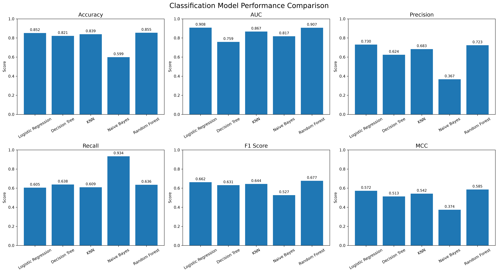
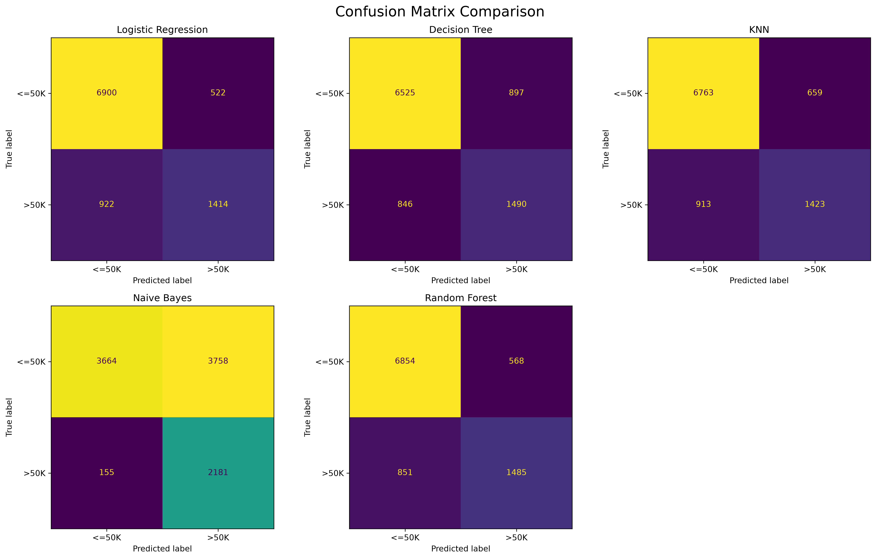

# Adult Census Income Classification

## 1. Problem Statement

The objective of this project is to implement and compare five machine-learning classification algorithms to predict whether an individual's annual income exceeds $50,000 based on demographic, educational and employment-related attributes.

This is a binary classification problem with two target classes:

- `<=50K`: Annual income at or below $50,000.
- `>50K`: Annual income above $50,000.

The project evaluates five classification algorithms using six performance metrics and identifies the best-performing model.

## 2. Dataset Description

**Dataset:** Adult Census Income Dataset  
**Source:** UCI Machine Learning Repository  
**Dataset URL:** https://archive.ics.uci.edu/dataset/2/adult

### Dataset characteristics

| Attribute | Description |
|---|---|
| Original records | 48,842 |
| Original input features | 14 |
| Target variable | income |
| Classification type | Binary |
| Numerical features | 6 |
| Categorical features | 8 |
| Original columns | 15 |

### Features

The dataset contains the following input features:

1. age
2. workclass
3. fnlwgt
4. education
5. education-num
6. marital-status
7. occupation
8. relationship
9. race
10. sex
11. capital-gain
12. capital-loss
13. hours-per-week
14. native-country

The target variable is `income`.

### Class distribution after data cleaning

| Income Class | Records | Percentage |
|---|---:|---:|
| <=50K | 37,109 | 76.06% |
| >50K | 11,681 | 23.94% |
| Total | 48,790 | 100% |

The dataset exhibits class imbalance, with the <=50K category representing approximately 76% of the observations.

## 3. GitHub Repository Link

**Repository URL:** https://github.com/AbhisekGhosh2026CT05025/ML-Assignment-2

The repository contains:

- Complete Python source code
- requirements.txt
- README.md
- Test dataset (CSV)
- Trained model files
- Model evaluation results
- Performance visualization graphs

## 4. Data Preprocessing

The following preprocessing operations were performed.

### 4.1 Missing Value Handling

Missing values were identified in:

- workclass
- occupation
- native-country

Both actual null values and '?' markers were identified and converted into missing values.

Numerical missing values were handled using median imputation.

Categorical missing values were handled using most-frequent-value imputation.

### 4.2 Duplicate Removal

A total of 52 duplicate records were identified and removed after normalizing missing-value markers.

Final cleaned dataset: 48,790 records.

### 4.3 Categorical Encoding

One-Hot Encoding was applied to categorical features to convert categorical values into numerical representations.

The encoder was configured with handle_unknown='ignore'.

### 4.4 Feature Scaling

StandardScaler was applied to numerical features to normalize their scales.

### 4.5 Train-Test Split

The dataset was divided into:

- Training: 80% (39,032 records)
- Testing: 20% (9,758 records)

Stratified sampling was used to preserve the target class distribution.

Random seed: 42.

### 4.6 Prevention of Data Leakage

A Scikit-learn Pipeline and ColumnTransformer were used.

Preprocessing parameters were fitted exclusively on the training dataset. The same fitted transformations were subsequently applied to the testing dataset.

### 4.7 Final Feature Representation

| Attribute | Value |
|---|---:|
| Original input features | 14 |
| Encoded features | 105 |
| Training records | 39,032 |
| Testing records | 9,758 |

No missing values remained after preprocessing.

## 5. Machine Learning Models Used

Five classification algorithms were implemented using the same dataset and train-test split.

### 5.1 Logistic Regression

Configuration:
- max_iter = 1000
- random_state = 42

### 5.2 Decision Tree Classifier

Configuration:
- random_state = 42

### 5.3 K-Nearest Neighbors

Configuration:
- n_neighbors = 5
- weights = uniform

### 5.4 Gaussian Naive Bayes

Gaussian Naive Bayes was implemented using the GaussianNB classifier.

### 5.5 Random Forest Classifier

Configuration:
- n_estimators = 200
- random_state = 42
- n_jobs = -1

## 6. Model Evaluation and Comparison

All five models were evaluated using the following metrics:

- Accuracy
- AUC Score
- Precision
- Recall
- F1 Score
- Matthews Correlation Coefficient (MCC)

The positive classification category was defined as income >50K.

### 6.1 Model Comparison Table

| ML Model | Accuracy | AUC | Precision | Recall | F1 Score | MCC |
|---|---:|---:|---:|---:|---:|---:|
| Logistic Regression | 0.8520 | 0.9081 | 0.7304 | 0.6053 | 0.6620 | 0.5724 |
| Decision Tree | 0.8214 | 0.7587 | 0.6242 | 0.6378 | 0.6310 | 0.5132 |
| KNN | 0.8389 | 0.8667 | 0.6835 | 0.6092 | 0.6442 | 0.5420 |
| Naive Bayes | 0.5990 | 0.8174 | 0.3672 | 0.9336 | 0.5271 | 0.3736 |
| Random Forest | 0.8546 | 0.9072 | 0.7233 | 0.6357 | 0.6767 | 0.5854 |

### 6.2 Graphical Representation

#### Model Performance Comparison



#### Confusion Matrix Comparison



#### ROC Curve Comparison


## 7. Observations on Model Performance

### Logistic Regression

Logistic Regression achieved 85.20% accuracy and the highest AUC score of 0.9081.

It demonstrated strong discrimination and the highest precision of 0.7304. However, its recall of 0.6053 indicates that some high-income individuals were incorrectly classified as low-income.

### Decision Tree

Decision Tree achieved 82.14% accuracy and an AUC score of 0.7587.

It captured nonlinear relationships but demonstrated comparatively weaker discrimination than the other models.

### K-Nearest Neighbors

KNN achieved 83.89% accuracy and an AUC score of 0.8667.

It demonstrated reasonable classification performance, with moderate precision and recall.

Feature scaling was important because KNN relies on distance calculations.

### Naive Bayes

Naive Bayes achieved the highest recall of 0.9336 but relatively low precision of 0.3672.

It correctly identified a large proportion of high-income individuals but generated many false-positive predictions.

This indicates that the model prioritizes identifying positive cases at the expense of precision.

### Random Forest

Random Forest achieved the highest accuracy of 85.46%, F1 score of 0.6767 and MCC of 0.5854.

The ensemble approach combines multiple decision trees and provides the strongest overall balance among the evaluated models.

## 8. Overall Winner

**Random Forest Classifier**

Random Forest was selected as the overall winner based on the combined evaluation metrics.

It achieved:

- Accuracy: 85.46%
- AUC: 0.9072
- Precision: 0.7233
- Recall: 0.6357
- F1 Score: 0.6767
- MCC: 0.5854

Logistic Regression achieved a marginally higher AUC and precision. However, Random Forest achieved the highest accuracy, F1 score and MCC.

Therefore, Random Forest demonstrated the best overall performance for this dataset under the selected evaluation criteria.

## 9. Project Execution Instructions

### Prerequisites

- Python 3.x
- pip
- Required Python libraries

### Installation

Clone the repository:

```bash
git clone https://github.com/AbhisekGhosh2026CT05025/ML-Assignment-2
```

Navigate to the project directory:

```bash
cd ML-Assignment-2
```

Install dependencies:

```bash
pip install -r requirements.txt
```

### Execution sequence

Run the following scripts in order:

```bash
python 01_download_dataset.py

python 02_explore_dataset.py

python 03_preprocess_split.py

python 04_train_models.py

python 05_visualize_results.py
```

### Generated outputs

- Cleaned training and testing datasets
- Preprocessing pipeline
- Five trained classification models
- Model comparison CSV
- Performance comparison graphs
- Confusion matrices
- ROC curve comparison

## 10. Repository Structure

```text
ML-Assignment-2/
│
├── data/
│   ├── train_data.csv
│   ├── test_data.csv
│   ├── X_train_processed.npy
│   ├── X_test_processed.npy
│   ├── y_train.npy
│   └── y_test.npy
│
├── models/
│   ├── preprocessor.pkl
│   ├── logistic_regression.pkl
│   ├── decision_tree.pkl
│   ├── knn.pkl
│   ├── naive_bayes.pkl
│   └── random_forest.pkl
│
├── outputs/
│   ├── model_comparison.csv
│   └── graphs/
│       ├── model_metrics_comparison.png
│       ├── confusion_matrices.png
│       └── roc_comparison.png
│
├── 01_download_dataset.py
├── 02_explore_dataset.py
├── 03_preprocess_split.py
├── 04_train_models.py
├── 05_visualize_results.py
├── requirements.txt
└── README.md
```

## 11. Conclusion

This project implemented five machine-learning classification algorithms to predict income categories using the Adult Census Income dataset.

Data cleaning, missing-value imputation, duplicate removal, categorical encoding, feature scaling and stratified train-test splitting were performed.

The models were evaluated using six classification metrics.

Random Forest achieved the best overall balance, with 85.46% accuracy, a 0.6767 F1 score and 0.5854 MCC.

The experiment demonstrates that different classification algorithms exhibit different strengths depending on the evaluation metric and the characteristics of the dataset.
